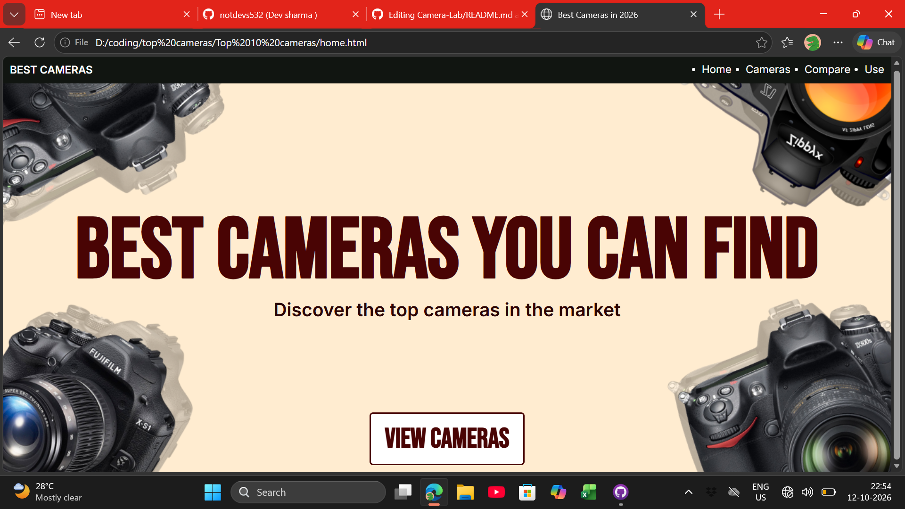
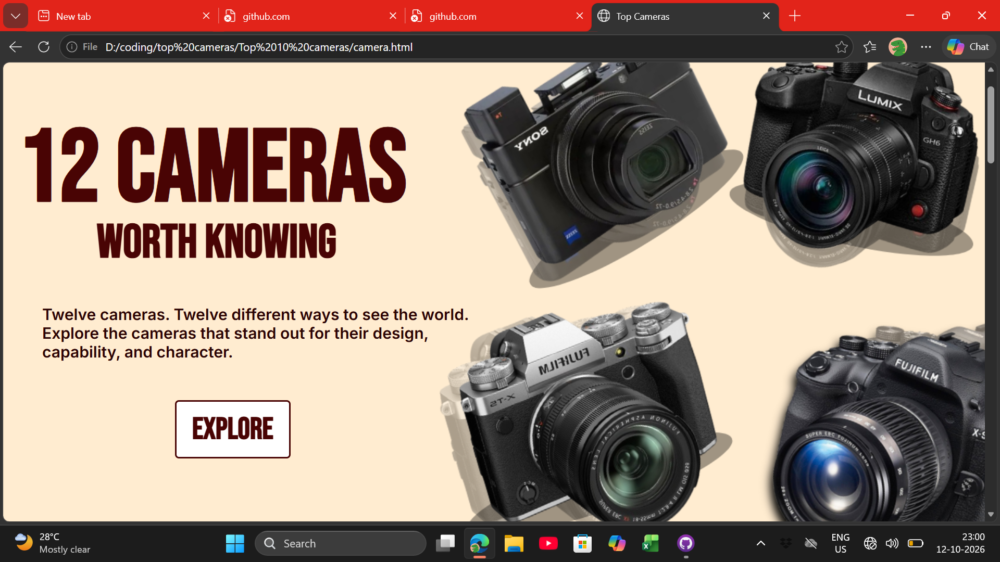
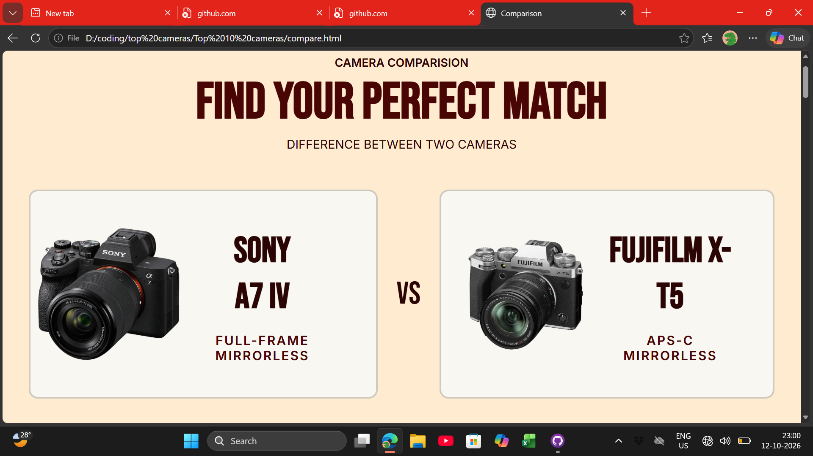
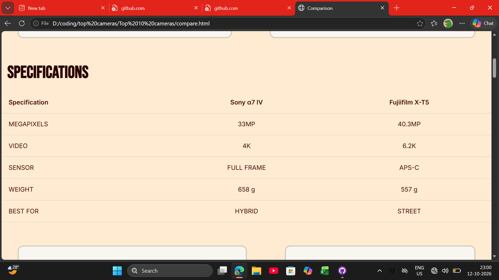
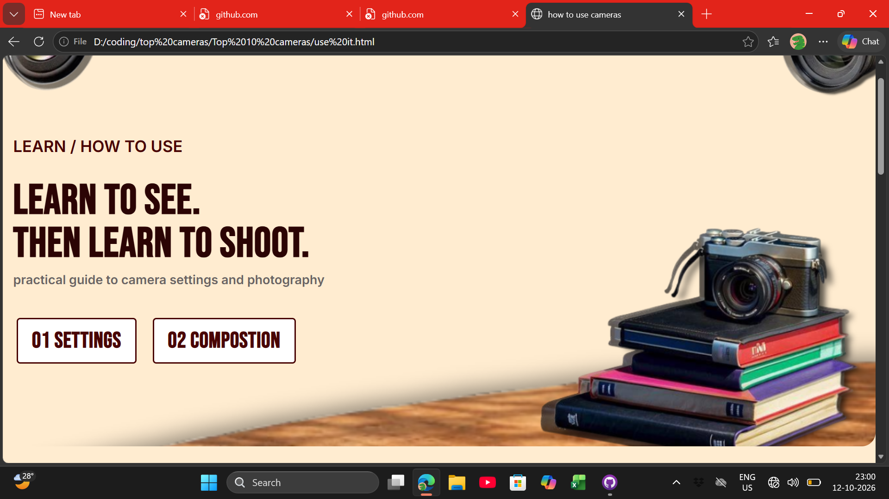
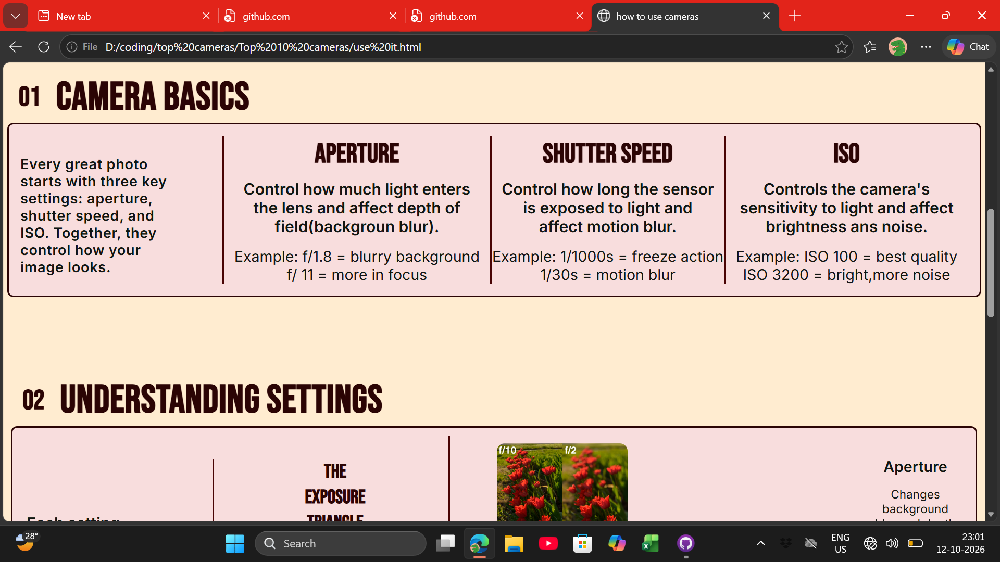
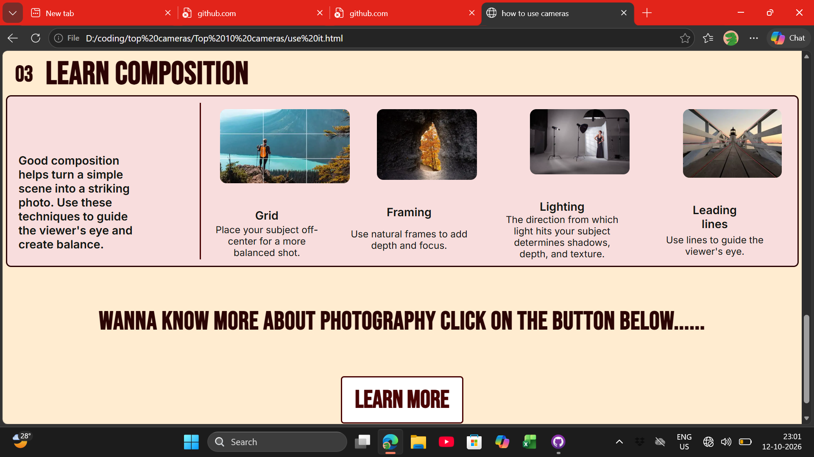

# CAMERA LAB
It is a website that includes basic knowledge about cameras and photography.

It has 4 different web pages each one includes different sector.
## HOME PAGE 

## Top cameras page 

## Compare cameras page

## How to use cameras page 

# AI usage 
Ai is used for camera info, photography defination,dubbuging and help in making cards of top 12 cameras section.

NO COPY PASTE OF CODES ARE CONDUCTED.
